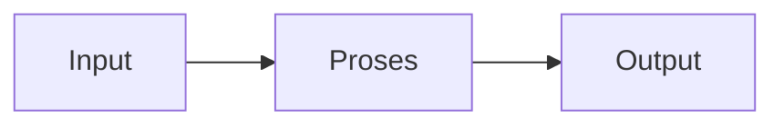

## Universitas Harkat Negeri
### SIF3002 — Dasar Pemrograman

Bima Laksana Putra, S.ST., M.M.

# IMPLEMENTASI SEQUENCE, SELECTION, ITERATION, INPUT, DAN OUTPUT

# Capaian Pembelajaran

Setelah mempelajari materi ini, mahasiswa diharapkan mampu:

1. Menjelaskan sequence, selection, dan iteration dalam program Python.
2. Menerima input teks dan angka menggunakan `input()`.
3. Menampilkan informasi menggunakan `print()`.
4. Mengubah input teks menjadi tipe data angka sesuai kebutuhan.
5. Menggabungkan input/output dengan sequence, selection, dan iteration.
6. Menulis program interaktif sederhana tanpa menggunakan array atau daftar.

# Pengantar

Pada pertemuan sebelumnya kita mempelajari struktur kontrol **sequence**, **selection**, dan **iteration** dalam algoritma. Pada pertemuan ini, kita menerapkannya menggunakan Python dan belajar berinteraksi dengan pengguna melalui **input** dan **output**.

| Konsep | Kegunaan | Bentuk Python |
| ---- | ---- | ---- |
| Sequence | Menjalankan instruksi secara berurutan | Urutan pernyataan |
| Selection | Memilih tindakan berdasarkan kondisi | `if`, `elif`, `else` |
| Iteration | Mengulang instruksi | `for`, `while` |
| Input | Menerima data dari pengguna | `input()` |
| Output | Menampilkan informasi | `print()` |

Program sederhana biasanya mengikuti alur berikut:



> Contoh di materi ini menggunakan variabel sederhana. Array dan daftar data belum dibahas.

# 1. Sequence: Instruksi Berurutan

## Pengertian

**Sequence** adalah rangkaian instruksi yang dijalankan berurutan dari atas ke bawah. Program dapat menerima data, mengolah data, lalu menampilkan hasil.

## Contoh: Luas Persegi Panjang

```python
panjang = 8
lebar = 5
luas = panjang * lebar

print(f"Luas persegi panjang: {luas}")
```

Hasil:

```
Luas persegi panjang: 40
```

Urutan program:

1. Menyimpan nilai panjang.
2. Menyimpan nilai lebar.
3. Menghitung luas.
4. Menampilkan luas.

## Contoh Sequence dengan Input

```python
nama = input("Masukkan nama: ")
print(f"Halo, {nama}!")
```

`input()` menampilkan pertanyaan dan menunggu pengguna mengetik jawaban. Nilai yang dimasukkan disimpan ke variabel `nama`, kemudian ditampilkan dengan `print()`.

# 2. Input dan Output

## Menampilkan Output dengan `print()`

Fungsi `print()` menampilkan teks atau nilai ke output.

```python
nama = "Ayu"
umur = 19

print("Nama:", nama)
print("Umur:", umur)
```

Kita juga dapat memakai **f-string** untuk menyisipkan nilai variabel ke dalam teks:

```python
nama = "Bima"
umur = 20

print(f"{nama} berusia {umur} tahun.")
```

## Menerima Input dengan `input()`

Nilai yang dibaca dengan `input()` selalu berupa teks (`str`), walaupun pengguna mengetik angka.

```python
nama = input("Masukkan nama: ")
print(f"Selamat datang, {nama}!")
```

## Mengubah Input Menjadi Angka

Gunakan `int()` untuk bilangan bulat dan `float()` untuk bilangan desimal.

```python
umur = int(input("Masukkan umur: "))
tinggi = float(input("Masukkan tinggi dalam meter: "))

print(f"Umur: {umur} tahun")
print(f"Tinggi: {tinggi} meter")
```

Jika input angka tidak diubah tipenya, operasi aritmetika dapat menghasilkan perilaku yang tidak diinginkan. Contoh berikut menggabungkan dua teks, bukan menjumlahkan bilangan:

```python
angka_teks = input("Masukkan angka: ")
print(angka_teks + angka_teks)
```

Misalnya pengguna memasukkan `3`, hasilnya adalah `33`. Agar dijumlahkan sebagai angka, ubah terlebih dahulu dengan `int()`:

```python
angka = int(input("Masukkan angka: "))
print(angka + angka)
```

## Contoh: Menghitung Luas dengan Input

```python
panjang = float(input("Masukkan panjang: "))
lebar = float(input("Masukkan lebar: "))

luas = panjang * lebar

print(f"Luas persegi panjang: {luas}")
```

Program menjalankan sequence **input → proses → output**.

# 3. Selection: Memilih Berdasarkan Kondisi

## Pengertian

**Selection** digunakan ketika program harus memilih tindakan berdasarkan suatu kondisi. Kondisi menghasilkan nilai `True` atau `False`.

## Bentuk `if`

Gunakan `if` untuk menjalankan tindakan hanya jika kondisi benar.

```python
saldo = 150_000
harga_barang = 120_000

if saldo >= harga_barang:
    print("Saldo cukup untuk membeli barang.")
```

Isi blok `if` ditulis menjorok ke dalam. Indentasi empat spasi merupakan kebiasaan umum di Python.

## Bentuk `if-else`

Gunakan `if-else` jika ada dua kemungkinan tindakan.

```python
nilai = 72

if nilai >= 60:
    print("Lulus")
else:
    print("Belum lulus")
```

## Selection dengan Input

```python
nilai = float(input("Masukkan nilai: "))

if nilai >= 60:
    print("Lulus")
else:
    print("Belum lulus")
```

Pengguna memasukkan nilai, lalu program memilih pesan sesuai kondisi.

## Bentuk `if-elif-else`

Gunakan `elif` jika terdapat lebih dari dua kemungkinan.

```python
nilai = 86

if nilai >= 90:
    grade = "A"
elif nilai >= 80:
    grade = "B"
elif nilai >= 70:
    grade = "C"
elif nilai >= 60:
    grade = "D"
else:
    grade = "E"

print(f"Grade: {grade}")
```

Urutan kondisi penting. Kondisi dengan batas nilai tertinggi diperiksa lebih dahulu agar nilai tidak lebih dulu masuk ke kategori yang lebih rendah.

## Selection dengan Operator Logika

Kondisi dapat digabung menggunakan `and`, `or`, dan `not`.

```python
umur = int(input("Masukkan umur: "))
memiliki_kartu_mahasiswa = input("Memiliki kartu mahasiswa? (ya/tidak): ")

if umur >= 17 and memiliki_kartu_mahasiswa == "ya":
    print("Persyaratan terpenuhi.")
else:
    print("Persyaratan belum terpenuhi.")
```

# 4. Iteration: Mengulang Instruksi

## Pengertian

**Iteration** atau perulangan menjalankan kembali satu atau beberapa instruksi. Pada materi ini, perulangan digunakan dengan penghitung sederhana, bukan untuk mengolah array atau daftar.

## Perulangan `for` dengan `range()`

Gunakan `for` ketika jumlah pengulangan sudah diketahui.

```python
for nomor in range(1, 6):
    print(nomor)
```

Hasil:

```
1
2
3
4
5
```

`range(1, 6)` menghasilkan angka 1 sampai 5. Batas akhir `6` tidak disertakan.

## Menjumlahkan Angka dengan Perulangan

```python
total = 0

for angka in range(1, 4):
    total = total + angka

print(f"Jumlah: {total}")
```

Setiap putaran menambahkan nilai penghitung ke `total`. Program menghitung `1 + 2 + 3`, sehingga hasilnya `6`.

## Perulangan `while`

Gunakan `while` ketika instruksi perlu diulang selama kondisi masih benar.

```python
nomor = 1

while nomor <= 5:
    print(nomor)
    nomor = nomor + 1
```

Pastikan nilai yang diperiksa dalam kondisi berubah di dalam perulangan. Tanpa perubahan `nomor`, kondisi akan selalu benar dan perulangan tidak berhenti.

## Mengulang Input dengan `for`

Perulangan juga dapat meminta input beberapa kali. Contoh ini meminta satu nilai untuk setiap putaran dan langsung memprosesnya.

```python
total = 0

for nomor in range(1, 4):
    nilai = float(input(f"Masukkan nilai ke-{nomor}: "))
    total = total + nilai

rata_rata = total / 3
print(f"Rata-rata: {rata_rata:.2f}")
```

Nilai setiap putaran langsung ditambahkan ke `total`; program tidak menyimpan kumpulan nilai.


## Studi Kasus: Pemeriksaan Nilai Tiga Mahasiswa

Program berikut meminta nilai tiga mahasiswa, satu per putaran. Setiap nilai langsung diperiksa dan ditampilkan.

```python
for nomor_mahasiswa in range(1, 4):
    nilai = float(input(f"Masukkan nilai mahasiswa ke-{nomor_mahasiswa}: "))

    if nilai >= 60:
        status = "Lulus"
    else:
        status = "Belum lulus"

    print(f"Mahasiswa ke-{nomor_mahasiswa}: {status}")
```

**Identifikasi struktur:**

| Bagian program | Struktur |
| ---- | ---- |
| Meminta nilai, menentukan status, lalu menampilkan hasil | Sequence |
| Memilih status berdasarkan nilai | Selection |
| Mengulang proses sebanyak tiga kali | Iteration |
| Membaca nilai dan menampilkan status | Input dan output |

# 6. Contoh Program Terpadu: Total Belanja Satu Barang

Contoh ini menggunakan input untuk harga dan jumlah, selection untuk menentukan diskon, lalu output untuk menampilkan hasil.

```python
harga = float(input("Masukkan harga barang: "))
jumlah = int(input("Masukkan jumlah barang: "))

total = harga * jumlah

if total >= 100_000:
    diskon = total * 0.10
else:
    diskon = 0

total_bayar = total - diskon

print(f"Total sebelum diskon: Rp{total:,.0f}")
print(f"Diskon: Rp{diskon:,.0f}")
print(f"Total bayar: Rp{total_bayar:,.0f}")
```

> Program ini menangani satu jenis barang. Pengolahan banyak jenis barang atau kumpulan data akan dipelajari pada materi berikutnya.

# 7. Kesalahan Umum

1. **Lupa mengubah input angka.** `input()` menghasilkan teks; gunakan `int()` atau `float()` untuk perhitungan.
2. **Indentasi salah.** Isi `if`, `for`, dan `while` harus ditulis menjorok secara konsisten.
3. **Kondisi `while` tidak berubah.** Hal ini dapat membuat program berulang tanpa henti.
4. **Batas `range()` keliru.** Angka akhir pada `range()` tidak ikut dihasilkan.
5. **Urutan selection kurang tepat.** Periksa kondisi nilai tertinggi lebih dahulu.
6. **Mengira `print()` dan `input()` memiliki fungsi yang sama.** `input()` menerima data, sedangkan `print()` menampilkan data.

# Kuis Cepat

Tentukan hasil atau jawaban dari setiap pertanyaan.

1. Apa hasil program berikut?

   ```python
   for angka in range(2, 5):
       print(angka)
   ```

2. Apa yang ditampilkan jika pengguna memasukkan nilai `55`?

   ```python
   nilai = float(input("Nilai: "))

   if nilai >= 60:
       print("Lulus")
   else:
       print("Belum lulus")
   ```

3. Apa perbedaan `input()` dan `print()`?
4. Mengapa `int()` atau `float()` diperlukan untuk input angka?
5. Berapa kali perulangan berikut dijalankan?

   ```python
   for nomor in range(1, 4):
       print(nomor)
   ```

6. Mengapa variabel `nomor` harus bertambah pada contoh `while`?

# Tugas

## Latihan 1: Perkenalan

Buat program yang:

1. Meminta nama dan umur pengguna.
2. Menampilkan kalimat perkenalan menggunakan f-string.

## Latihan 2: Kelulusan

Buat program yang meminta satu nilai. Tampilkan `"Lulus"` jika nilai minimal 60 dan `"Belum lulus"` jika kurang dari 60.

## Latihan 3: Konversi Suhu

Buat program yang meminta suhu dalam Celsius, menghitung Fahrenheit dengan rumus:

`fahrenheit = (celsius * 9 / 5) + 32`

Kemudian tampilkan hasil konversinya.

## Latihan 4: Jumlah dan Rata-Rata

Buat program yang meminta nilai dari pengguna sebanyak tiga kali menggunakan `for` dan `range()`. Tambahkan setiap input ke variabel `total`, kemudian tampilkan total dan rata-ratanya. Jangan menyimpan nilai-nilai tersebut dalam array atau daftar.

## Latihan 5: Analisis Bilangan

Buat program yang meminta sebuah bilangan bulat. Gunakan selection untuk menentukan apakah bilangan tersebut positif, negatif, atau nol. Tambahkan perulangan agar program memeriksa bilangan sebanyak tiga kali.

## Ketentuan

1. Gunakan `input()` untuk menerima data dan `print()` untuk menampilkan hasil.
2. Ubah input menjadi tipe angka ketika akan digunakan dalam perhitungan.
3. Gunakan struktur sequence, selection, dan iteration sesuai kebutuhan soal.
4. Gunakan variabel sederhana; jangan gunakan fungsi, array, atau daftar pada latihan ini.
5. Pastikan indentasi konsisten dan program dapat dijalankan.
