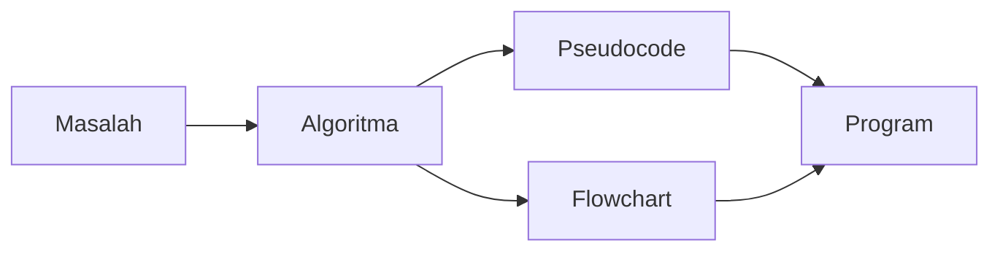
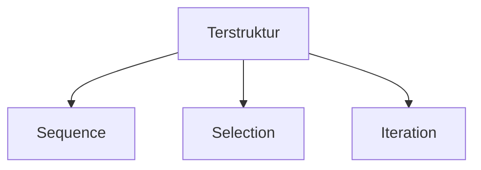
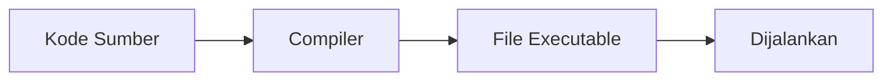
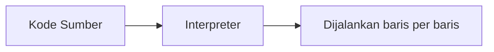
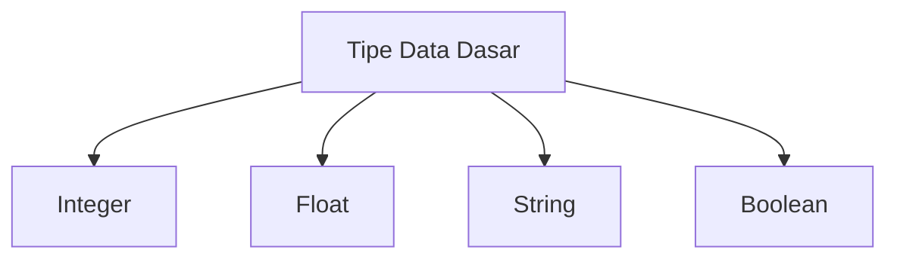

## Universitas Harkat Negeri
### SIF3002 — Dasar Pemrograman

Bima Laksana Putra, S.ST., M.M.

# PENGENALAN BAHASA PEMROGRAMAN PYTHON: TIPE DATA, VARIABEL, DAN OPERATOR

# Capaian Pembelajaran

1. Menjelaskan pengertian bahasa pemrograman terstruktur.
2. Menjelaskan perbedaan compiler dan interpreter.
3. Menjelaskan peran IDE dalam pengembangan program.
4. Menjelaskan tipe data dasar dalam Python: integer, float, string, dan boolean.
5. Menggunakan variabel untuk menyimpan data.
6. Menggunakan operator aritmetika, relasi, dan logika.
7. Menyusun ekspresi menggunakan variabel, nilai, dan operator.
8. Menulis dan menjalankan program Python sederhana.

## Review Materi Sebelumnya

Sebelumnya kita menulis solusi menggunakan **pseudocode** dan **flowchart**.



> Pseudocode adalah rancangan. Program adalah rancangan yang diwujudkan menggunakan bahasa pemrograman.

Mulai pertemuan ini, kita mewujudkan pseudocode menjadi **program sungguhan** menggunakan bahasa **Python**.

# Bahasa Pemrograman Terstruktur

## Apa itu Bahasa Pemrograman?

Bahasa pemrograman adalah bahasa yang digunakan untuk **memberi instruksi kepada komputer**.

> Komputer tidak memahami bahasa manusia. Komputer memahami instruksi yang ditulis dalam bahasa pemrograman.

Contoh bahasa pemrograman:

1. Python;
2. Java;
3. C;
4. C++;
5. JavaScript;
6. dan lain-lain.

## Apa itu Bahasa Pemrograman Terstruktur?

Bahasa pemrograman terstruktur adalah bahasa yang mendukung **tiga struktur kontrol dasar** yang telah kita pelajari:



> Bahasa terstruktur memungkinkan kita menulis program yang rapi, mudah dibaca, dan mudah dipelihara.

Python adalah salah satu bahasa pemrograman terstruktur.

## Mengenal Python

Python adalah bahasa pemrograman tingkat tinggi (*high-level*) yang memiliki ciri:

1. **Mudah dibaca** — sintaks mendekati bahasa manusia.
2. **Interpreter** — dijalankan baris per baris (akan dibahas berikutnya).
3. **Serbaguna** — dipakai untuk web, data science, otomasi, dan lain-lain.
4. **Populer** — komunitas besar dan banyak pustaka pendukung.

**Mengapa Python cocok untuk pemula?**
> Karena sintaksnya sederhana sehingga kita bisa fokus pada **logika**, bukan pada aturan penulisan yang rumit.

## Pseudocode vs Python

Perhatikan perbedaan cara menulis hal yang sama:

**Pseudocode:**
```
START
  INPUT nama
  OUTPUT nama
END
```

**Python:**
```python
nama = input("Masukkan nama: ")
print(nama)
```

> Konsepnya sama, hanya cara penulisannya yang berbeda.

# Environment Setup: Compiler/Interpreter dan IDE

## Compiler vs Interpreter

Komputer hanya memahami bahasa mesin. Kode yang kita tulis harus **diterjemahkan** dahulu.

Ada dua cara menerjemahkan kode:

### Compiler

Menerjemahkan **seluruh kode sekaligus** menjadi file yang bisa dijalankan.



Contoh: bahasa C, C++.

### Interpreter

Menerjemahkan dan menjalankan kode **baris per baris**.



Contoh: Python, JavaScript.

### Perbandingan

| Aspek | Compiler | Interpreter |
| ---- | ---- | ---- |
| Cara kerja | Terjemahkan semua dulu | Terjemahkan baris per baris |
| Hasil | File executable | Langsung dijalankan |
| Menemukan error | Sekaligus sebelum dijalankan | Saat baris yang salah dijalankan |
| Contoh bahasa | C, C++ | Python |

> Python menggunakan **interpreter**.

## Apa itu IDE?

IDE (*Integrated Development Environment*) adalah aplikasi yang membantu kita menulis, menjalankan, dan memperbaiki program.

Fungsi utama IDE:

1. **Editor** — tempat menulis kode.
2. **Menjalankan program** — terhubung dengan interpreter.
3. **Debugger** — membantu mencari kesalahan.
4. **Highlight sintaks** — mewarnai kode agar mudah dibaca.

## Visual Studio Code

Pada mata kuliah ini kita menggunakan **Visual Studio Code (VS Code)** sebagai editor kode.

Langkah persiapan:

1. **Install Python** dari python.org.
2. **Install VS Code** dari code.visualstudio.com.
3. **Install ekstensi Python** di VS Code.
4. Buat file baru dengan ekstensi `.py`.

## Program Pertama: Hello World

Buat file bernama `hello.py`, lalu tulis:

```python
print("Hello, World!")
```

Jalankan program, hasilnya:

```
Hello, World!
```

**Penjelasan:**
> `print()` adalah perintah untuk menampilkan teks ke layar.

# Tipe Data Dasar

Tipe data menentukan **jenis nilai** yang bisa disimpan dan diolah oleh program.

Python memiliki beberapa tipe data dasar:



## Integer

Integer adalah tipe data untuk **bilangan bulat** (tanpa koma).

```python
umur = 20
jumlah_mahasiswa = 35
suhu = -5
```

Contoh integer: `20`, `35`, `-5`, `0`, `1000`.

## Float

Float adalah tipe data untuk **bilangan desimal** (dengan koma).

```python
tinggi = 170.5
berat = 55.2
phi = 3.14
```

Contoh float: `170.5`, `55.2`, `3.14`, `-0.75`.

> Perhatikan: Python menggunakan **titik** (`.`), bukan koma, untuk bilangan desimal.

## String

String adalah tipe data untuk **teks**. String ditulis di antara tanda kutip.

```python
nama = "Bima"
kota = 'Jakarta'
nim = "2201010001"
```

Contoh string: `"Halo"`, `'Dasar Pemrograman'`, `"2201010001"`.

> **Catatan penting:** Python tidak memiliki tipe data `character` terpisah seperti bahasa C. Satu karakter di Python adalah string dengan panjang satu.

```python
huruf = "A"   # ini string, bukan tipe char
```

## Boolean

Boolean adalah tipe data yang hanya memiliki **dua nilai**: benar atau salah.

```python
lulus = True
hadir = False
```

Contoh boolean: `True`, `False`.

> **Perhatikan:** `True` dan `False` ditulis dengan huruf kapital di awal.

## Mengetahui Tipe Data

Gunakan fungsi `type()` untuk melihat tipe data suatu nilai:

```python
print(type(20))       # <class 'int'>
print(type(3.14))     # <class 'float'>
print(type("Halo"))   # <class 'str'>
print(type(True))     # <class 'bool'>
```

## Ringkasan Tipe Data

| Tipe Data | Nama Python | Contoh | Keterangan |
| ---- | ---- | ---- | ---- |
| Integer | `int` | `20` | Bilangan bulat |
| Float | `float` | `3.14` | Bilangan desimal |
| String | `str` | `"Halo"` | Teks |
| Boolean | `bool` | `True` | Benar/salah |

# Variabel

## Apa itu Variabel?

Variabel adalah **tempat menyimpan data** yang diberi nama.

```python
nama = "Bima"
umur = 20
```

**Analogi:**
> Variabel ibarat kotak berlabel. Label adalah nama variabel, isi kotak adalah nilai.

## Aturan Penamaan Variabel

1. Tidak boleh diawali angka (`2nama` salah).
2. Tidak boleh mengandung spasi (`nama mahasiswa` salah).
3. Tidak boleh memakai kata khusus Python (`if`, `for`, `while`, dll.).
4. Bersifat *case-sensitive* (`Nama` berbeda dengan `nama`).
5. Umumnya memakai huruf kecil dan garis bawah (`nama_mahasiswa`).

## Menetapkan Nilai

Gunakan tanda `=` untuk memberikan nilai ke variabel:

```python
sisi = 5
luas = sisi * sisi
print(luas)
```

**Hasil:**
```
25
```

## Python Bersifat Dinamis

Tipe data variabel di Python **tidak perlu dideklarasikan** terlebih dahulu.

```python
x = 10        # x bertipe integer
x = "Halo"    # x sekarang bertipe string
```

> Nilai variabel bisa berubah, bahkan bisa berganti tipe.

# Operator

Operator adalah simbol yang digunakan untuk **melakukan operasi** terhadap nilai.

Tiga kelompok operator yang kita pelajari:

1. Operator aritmetika;
2. Operator relasi;
3. Operator logika.

## Operator Aritmetika

Operator aritmetika digunakan untuk operasi **perhitungan**.

| Operator | Nama | Contoh | Hasil |
| ---- | ---- | ---- | ---- |
| `+` | Penjumlahan | `5 + 2` | `7` |
| `-` | Pengurangan | `5 - 2` | `3` |
| `*` | Perkalian | `5 * 2` | `10` |
| `/` | Pembagian | `5 / 2` | `2.5` |
| `//` | Pembagian bulat | `5 // 2` | `2` |
| `%` | Sisa bagi (modulus) | `5 % 2` | `1` |
| `**` | Pangkat | `5 ** 2` | `25` |

Contoh:

```python
a = 10
b = 3

print(a + b)   # 13
print(a - b)   # 7
print(a * b)   # 30
print(a / b)   # 3.3333...
print(a // b)  # 3
print(a % b)   # 1
print(a ** b)  # 1000
```

> Perbedaan penting: `/` menghasilkan float, sedangkan `//` membuang sisa dan menghasilkan integer.

## Operator Relasi

Operator relasi digunakan untuk **membandingkan** dua nilai. Hasilnya selalu boolean (`True` atau `False`).

| Operator | Nama | Contoh | Hasil |
| ---- | ---- | ---- | ---- |
| `==` | Sama dengan | `5 == 5` | `True` |
| `!=` | Tidak sama dengan | `5 != 5` | `False` |
| `>` | Lebih besar | `5 > 3` | `True` |
| `<` | Lebih kecil | `5 < 3` | `False` |
| `>=` | Lebih besar atau sama | `5 >= 5` | `True` |
| `<=` | Lebih kecil atau sama | `5 <= 3` | `False` |

Contoh:

```python
nilai = 75

print(nilai >= 60)   # True
print(nilai < 60)    # False
print(nilai == 100)  # False
```

## Operator Logika

Operator logika digunakan untuk **menggabungkan** beberapa kondisi.

| Operator | Nama | Hasil `True` jika |
| ---- | ---- | ---- |
| `and` | Dan | Kedua kondisi benar |
| `or` | Atau | Salah satu kondisi benar |
| `not` | Bukan | Kondisi bernilai salah |

### and

```python
print(True and True)    # True
print(True and False)   # False
print(False and False)  # False
```

> `and` bernilai `True` hanya jika **keduanya** benar.

### or

```python
print(True or False)    # True
print(False or False)   # False
```

> `or` bernilai `True` jika **salah satu** benar.

### not

```python
print(not True)   # False
print(not False)  # True
```

> `not` membalik nilai kondisi.

### Contoh Gabungan

```python
umur = 20
aktif = True

print(umur >= 17 and aktif)   # True
print(umur < 17 or aktif)     # True
print(not aktif)              # False
```

## Prioritas Operator

Jika ada banyak operator, urutan pengerjaan mengikuti prioritas berikut (dari yang paling tinggi):

1. Tanda kurung `()`
2. Pangkat `**`
3. Perkalian, pembagian, modulus `*`, `/`, `//`, `%`
4. Penjumlahan, pengurangan `+`, `-`
5. Operator relasi `==`, `!=`, `>`, `<`, `>=`, `<=`
6. `not`
7. `and`
8. `or`

Contoh:

```python
print(2 + 3 * 4)        # 14 (perkalian dikerjakan dulu)
print((2 + 3) * 4)      # 20 (kurung diprioritaskan)
```

> Gunakan tanda kurung agar ekspresi mudah dibaca dan tidak salah arti.

# Ekspresi

## Apa itu Ekspresi?

Ekspresi adalah **kombinasi** dari nilai, variabel, dan operator yang menghasilkan **satu nilai**.

```python
hasil = (10 + 5) * 2
```

Komponen ekspresi di atas:

* `10`, `5`, `2` → nilai;
* `+`, `*` → operator;
* `(10 + 5) * 2` → ekspresi yang menghasilkan nilai `30`.

## Contoh Ekspresi

### Menghitung Luas Persegi Panjang

```python
panjang = 10
lebar = 5
luas = panjang * lebar
print(luas)
```

**Hasil:**
```
50
```

### Menghitung Rata-rata

```python
nilai1 = 80
nilai2 = 90
nilai3 = 85
rata = (nilai1 + nilai2 + nilai3) / 3
print(rata)
```

**Hasil:**
```
85.0
```

### Menentukan Kelulusan (Ekspresi Boolean)

```python
nilai = 75
batas = 60
lulus = nilai >= batas
print(lulus)
```

**Hasil:**
```
True
```

> Ekspresi `nilai >= batas` menghasilkan nilai boolean yang disimpan ke variabel `lulus`.

## Menampilkan Hasil Ekspresi

Kita bisa langsung menampilkan hasil ekspresi tanpa menyimpannya dahulu:

```python
print(10 + 5)
print(3 * 4)
print(10 > 3)
```

**Hasil:**
```
15
12
True
```

# Kuis Cepat

Tentukan hasil dari setiap ekspresi berikut:

Kasus A
```python
print(7 // 2)
```

Kasus B
```python
print(7 % 2)
```

Kasus C
```python
print(3 ** 3)
```

Kasus D
```python
print(10 / 4)
```

Kasus E
```python
print(5 == 5)
```

Kasus F
```python
print(4 > 2 and 3 < 1)
```

Kasus G
```python
print(not (10 < 20))
```

Kasus H
```python
print(2 + 3 * 2)
```

# Tugas

## Latihan Program Sederhana

Buat program Python untuk kasus berikut, kemudian jalankan di VS Code:

1. Menghitung luas persegi panjang.
2. Menghitung luas lingkaran (gunakan nilai `phi = 3.14`).
3. Menghitung konversi suhu Celsius ke Fahrenheit.
4. Menghitung rata-rata dari tiga nilai.
5. Menghitung total harga belanja setelah diskon tetap.

## Latihan Ekspresi

Untuk setiap kasus di atas, tuliskan juga **ekspresi** yang digunakan (rumus perhitungannya).

## Ketentuan

1. Dikerjakan secara individu.
2. Setiap program harus disimpan dalam file `.py` yang terpisah.
3. Gunakan nama variabel yang jelas dan konsisten (huruf kecil dan garis bawah).
4. Sertakan komentar singkat (`#`) untuk menjelaskan setiap langkah.
5. Tampilkan hasil dengan `print()`.
6. Kumpulkan hasil eksekusi (screenshot output) beserta file kodenya.
