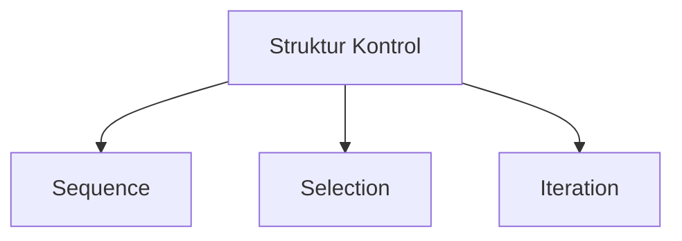
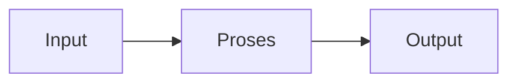
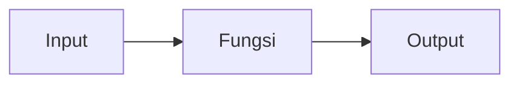
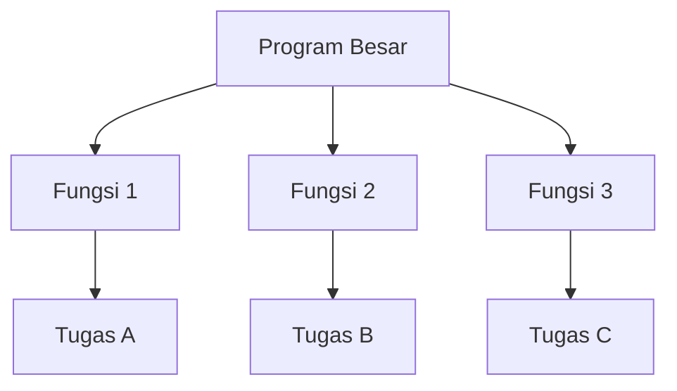

## Universitas Harkat Negeri
### SIF3002 — Dasar Pemrograman

Bima Laksana Putra, S.ST., M.M.

# IMPLEMENTASI SEQUENCE-SELECTION-ITERATION, FUNGSI, PARAMETER, RETURN VALUE, DAN MODULARISASI

# Capaian Pembelajaran

Setelah mempelajari materi ini, mahasiswa diharapkan mampu:

1. Mengimplementasikan sequence, selection, dan iteration dalam program Python.
2. Menjelaskan pengertian fungsi dan prosedur.
3. Membedakan fungsi dan prosedur.
4. Mendefinisikan dan memanggil fungsi menggunakan `def`.
5. Menjelaskan perbedaan parameter dan argumen serta menggunakannya dalam fungsi.
6. Menggunakan nilai balik (`return value`) dari sebuah fungsi.
7. Menerapkan modularisasi dengan memecah program menjadi beberapa fungsi.
8. Menyusun program terstruktur yang menggabungkan sequence, selection, iteration, dan fungsi.

## Review Materi Sebelumnya

Pada pertemuan sebelumnya kita telah mempelajari:

1. Tipe data dasar (`int`, `float`, `str`, `bool`), variabel, dan operator.
2. Tiga struktur kontrol dasar: **sequence**, **selection**, dan **iteration**.
3. Cara menulis dan menjalankan program Python sederhana.



| Struktur | Fungsi | Bentuk Python |
| ---- | ---- | ---- |
| Sequence | Menjalankan instruksi berurutan | Urutan pernyataan |
| Selection | Memilih tindakan berdasarkan kondisi | `if`, `elif`, `else` |
| Iteration | Mengulangi instruksi | `for`, `while` |

**Pertanyaan kunci pertemuan ini:**
> Bagaimana mewujudkan struktur kontrol menjadi program Python yang rapi, lalu bagaimana mengorganisasi kode agar mudah dibaca dan dipelihara menggunakan **fungsi**?

# Pengantar

Program sederhana umumnya mengikuti alur berikut:



Selama ini kita menulis seluruh instruksi secara berurutan dalam satu blok. Semakin besar program, semakin sulit membacanya. Pertemuan ini kita pelajari cara **mengorganisasi kode menjadi bagian-bagian kecil yang bernama fungsi** (modularisasi), lengkap dengan **parameter** dan **return value**.

> Program yang baik tidak hanya benar hasilnya, tetapi juga rapi, mudah dibaca, dan mudah dipelihara.

# 1. Implementasi Sequence, Selection, dan Iteration

Sebelum membahas fungsi, kita wujudkan dahulu tiga struktur kontrol yang sudah dipelajari dalam bentuk Python.

## 1.1 Sequence: Instruksi Berurutan

**Sequence** adalah rangkaian instruksi yang dijalankan berurutan dari atas ke bawah.

```python
panjang = 8
lebar = 5
luas = panjang * lebar

print(f"Luas persegi panjang: {luas}")
```

Hasil:

```
Luas persegi panjang: 40
```

Urutan program:

1. Menyimpan nilai `panjang`.
2. Menyimpan nilai `lebar`.
3. Menghitung `luas`.
4. Menampilkan `luas`.

## 1.2 Selection: Memilih Berdasarkan Kondisi

**Selection** memilih tindakan berdasarkan kondisi yang bernilai `True` atau `False`.

### `if`

```python
saldo = 150_000
harga = 120_000

if saldo >= harga:
    print("Saldo cukup untuk membeli barang.")
```

> Isi blok `if` ditulis **menjorok ke dalam** (indentasi). Python menggunakan indentasi untuk menandai blok.

### `if-else`

```python
nilai = 72

if nilai >= 60:
    print("Lulus")
else:
    print("Belum lulus")
```

### `if-elif-else`

Gunakan `elif` jika terdapat lebih dari dua kemungkinan.

```python
nilai = 86

if nilai >= 90:
    grade = "A"
elif nilai >= 80:
    grade = "B"
elif nilai >= 70:
    grade = "C"
elif nilai >= 60:
    grade = "D"
else:
    grade = "E"

print(f"Grade: {grade}")
```

> **Urutan kondisi penting.** Kondisi dengan batas tertinggi diperiksa lebih dahulu, agar nilai tidak salah masuk ke kategori yang lebih rendah.

## 1.3 Iteration: Mengulang Instruksi

**Iteration** menjalankan kembali satu atau beberapa instruksi.

### `for` dengan `range()`

Gunakan `for` ketika jumlah pengulangan sudah diketahui.

```python
for nomor in range(1, 6):
    print(nomor)
```

Hasil:

```
1
2
3
4
5
```

> `range(1, 6)` menghasilkan angka 1 sampai 5. Batas akhir `6` **tidak** disertakan.

### `while`

Gunakan `while` ketika instruksi diulang selama kondisi masih benar.

```python
nomor = 1

while nomor <= 5:
    print(nomor)
    nomor = nomor + 1
```

> Pastikan nilai yang diperiksa kondisi **berubah** di dalam perulangan, agar perulangan dapat berhenti.

## 1.4 Menggabungkan Ketiga Struktur

Program nyata umumnya menggabungkan beberapa struktur. Contoh berikut meminta nilai tiga mahasiswa, lalu memutuskan status kelulusan masing-masing.

```python
for nomor_mahasiswa in range(1, 4):
    nilai = float(input(f"Masukkan nilai mahasiswa ke-{nomor_mahasiswa}: "))

    if nilai >= 60:
        status = "Lulus"
    else:
        status = "Belum lulus"

    print(f"Mahasiswa ke-{nomor_mahasiswa}: {status}")
```

Identifikasi struktur:

| Bagian program | Struktur |
| ---- | ---- |
| Meminta nilai, menentukan status, lalu menampilkan hasil | Sequence |
| Memilih status berdasarkan nilai | Selection |
| Mengulang proses sebanyak tiga kali | Iteration |

# 2. Fungsi dan Prosedur

## 2.1 Apa itu Fungsi?

Fungsi adalah **blok kode bernama** yang menjalankan satu tugas tertentu dan dapat dipanggil berulang kali.

Analogi:

> Fungsi ibarat **mesin**. Mesin menerima bahan (input), mengolahnya, lalu menghasilkan produk (output). Kita tidak perlu tahu detail di dalam mesin, cukup tahu apa yang dimasukkan dan apa yang dihasilkan.



Contoh sederhana:

```python
def sapa():
    print("Halo, selamat datang!")
```

## 2.2 Mengapa Menggunakan Fungsi?

1. **Menghindari penulisan ulang** kode yang sama.
2. **Memudahkan membaca** program karena tiap fungsi punya satu tugas.
3. **Memudahkan perbaikan** — cukup ubah satu fungsi, bukan seluruh program.
4. **Memudahkan pembagian kerja** dalam tim.

## 2.3 Apa itu Prosedur?

Prosedur adalah fungsi yang **melakukan suatu aksi tetapi tidak mengembalikan nilai**.

Di Python, prosedur dan fungsi **sama-sama ditulis dengan `def`**. Yang membedakan hanyalah ada atau tidaknya `return`.

```python
def tampilkan_menu():
    print("1. Lihat data")
    print("2. Tambah data")
    print("3. Keluar")
```

> `tampilkan_menu()` hanya menampilkan teks, tidak menghasilkan nilai untuk digunakan di tempat lain. Inilah yang disebut **prosedur**.

## 2.4 Fungsi vs Prosedur

| Aspek | Fungsi | Prosedur |
| ---- | ---- | ---- |
| Tujuan | Menghitung/menghasilkan nilai | Melakukan aksi |
| Mengembalikan nilai | Ya, dengan `return` | Tidak (mengembalikan `None`) |
| Cara penulisan di Python | `def` + `return` | `def` tanpa `return` |
| Contoh | `hitung_luas(...)` | `tampilkan_menu()` |

> Dalam bahasa seperti Pascal, `function` dan `procedure` adalah kata kunci yang berbeda. Python menyatukan keduanya melalui `def`.

## 2.5 Mendefinisikan Fungsi dengan `def`

Bentuk umum:

```python
def nama_fungsi(parameter):
    # isi fungsi
    return nilai
```

Komponen penting:

1. Kata kunci `def`.
2. Nama fungsi (aturan penamaan sama seperti variabel).
3. Tanda kurung `()` untuk parameter (boleh kosong).
4. Titik dua `:` di akhir baris.
5. Isi fungsi yang ditulis menjorok (indentasi).
6. `return` (opsional) untuk mengembalikan nilai.

## 2.6 Memanggil Fungsi

Fungsi yang sudah didefinisikan harus **dipanggil** agar dijalankan.

```python
def sapa():
    print("Halo!")

sapa()   # memanggil fungsi
```

Hasil:

```
Halo!
```

> Mendefinisikan fungsi **tidak** langsung menjalankannya. Fungsi hanya dijalankan saat dipanggil.

# 3. Parameter

## 3.1 Parameter vs Argumen

- **Parameter** adalah variabel yang ditulis dalam definisi fungsi, sebagai "tempat" menerima nilai.
- **Argumen** adalah nilai nyata yang dikirim saat fungsi dipanggil.

```python
def sapa(nama):          # "nama" adalah parameter
    print(f"Halo, {nama}!")

sapa("Bima")             # "Bima" adalah argumen
```

Hasil:

```
Halo, Bima!
```

> Nilai argumen mengalir ke parameter saat pemanggilan.

## 3.2 Fungsi dengan Satu Parameter

```python
def tampilkan_kuadrat(angka):
    hasil = angka ** 2
    print(f"Kuadrat dari {angka} adalah {hasil}")

tampilkan_kuadrat(7)
```

Hasil:

```
Kuadrat dari 7 adalah 49
```

## 3.3 Fungsi dengan Beberapa Parameter

```python
def tampilkan_data(nama, nim, prodi):
    print(f"Nama : {nama}")
    print(f"NIM  : {nim}")
    print(f"Prodi: {prodi}")

tampilkan_data("Ayu", "2201010001", "Sistem Informasi")
```

Urutan argumen harus sesuai dengan urutan parameter.

## 3.4 Parameter dengan Nilai Bawaan

Parameter dapat diberi nilai bawaan. Jika argumen tidak dikirim, nilai bawaan dipakai.

```python
def sapa(nama="Mahasiswa"):
    print(f"Halo, {nama}!")

sapa()           # memakai nilai bawaan
sapa("Bima")     # memakai argumen
```

Hasil:

```
Halo, Mahasiswa!
Halo, Bima!
```

# 4. Return Value

## 4.1 Mengembalikan Nilai dengan `return`

Gunakan `return` untuk mengembalikan nilai hasil fungsi kepada pemanggilnya.

```python
def luas_persegi_panjang(panjang, lebar):
    return panjang * lebar
```

Nilai yang dikembalikan dapat **disimpan** ke variabel atau **langsung dipakai**.

```python
def luas_persegi_panjang(panjang, lebar):
    return panjang * lebar

hasil = luas_persegi_panjang(8, 5)
print(hasil)

print(luas_persegi_panjang(10, 3))
```

Hasil:

```
40
30
```

## 4.2 `return` Menghentikan Fungsi

Ketika `return` dijalankan, fungsi **langsung selesai** dan kembali ke pemanggil. Baris setelah `return` tidak dijalankan.

```python
def bagi(a, b):
    if b == 0:
        return None       # langsung keluar jika pembagi nol
    return a / b

print(bagi(10, 2))
print(bagi(10, 0))
```

Hasil:

```
5.0
None
```

## 4.3 Fungsi vs Prosedur Berdasarkan `return`

```python
def hitung_luas(panjang, lebar):   # fungsi: mengembalikan nilai
    return panjang * lebar

def tampilkan_luas(luas):          # prosedur: hanya menampilkan
    print(f"Luasnya adalah {luas}")
```

```python
luas = hitung_luas(6, 4)
tampilkan_luas(luas)
```

Hasil:

```
Luasnya adalah 24
```

> Fungsi menghasilkan nilai untuk **dipakai di tempat lain**; prosedur hanya **melakukan aksi**.

# 5. Modularisasi

## 5.1 Apa itu Modularisasi?

Modularisasi adalah teknik **memecah program besar menjadi bagian-bagian kecil** (modul) yang masing-masing berupa fungsi.



Setiap fungsi bertanggung jawab atas **satu tugas**.

## 5.2 Mengapa Modularisasi?

1. Program lebih **mudah dibaca**.
2. Bagian yang sama bisa **dipakai ulang**.
3. Kesalahan lebih **mudah dilacak** (cukup periksa satu fungsi).
4. Tugas bisa **dibagi** ke beberapa orang dalam tim.

## 5.3 Langkah Memecah Program

1. **Identifikasi tugas-tugas utama** program.
2. **Buat satu fungsi untuk setiap tugas**.
3. **Tentukan parameter** yang dibutuhkan tiap fungsi.
4. **Tentukan apakah fungsi mengembalikan nilai** (`return`) atau hanya melakukan aksi.
5. **Panggil fungsi-fungsi** dari program utama.

## 5.4 Contoh Modularisasi Sederhana

Sebelumnya, program menghitung luas ditulis dalam satu blok. Sekarang dipecah menjadi fungsi.

```python
def hitung_luas(panjang, lebar):
    return panjang * lebar

def main():
    panjang = float(input("Masukkan panjang: "))
    lebar = float(input("Masukkan lebar: "))

    luas = hitung_luas(panjang, lebar)
    print(f"Luas persegi panjang: {luas}")

main()
```

Penjelasan:

- `hitung_luas()` bertugas menghitung dan **mengembalikan** nilai.
- `main()` bertugas menerima input dan menampilkan hasil.
- Tugas input, proses, dan output menjadi **terpisah dan jelas**.

## 5.5 Studi Kasus Terpadu: Kalkulator Sederhana

Program berikut menggabungkan sequence, selection, iteration, fungsi, parameter, return value, dan modularisasi.

```python
def tambah(a, b):
    return a + b

def kurang(a, b):
    return a - b

def kali(a, b):
    return a * b

def bagi(a, b):
    if b == 0:
        return None
    return a / b

def tampilkan_menu():
    print("=== Kalkulator Sederhana ===")
    print("1. Tambah")
    print("2. Kurang")
    print("3. Kali")
    print("4. Bagi")
    print("5. Keluar")

def main():
    while True:
        tampilkan_menu()
        pilihan = input("Pilih menu (1-5): ")

        if pilihan == "5":
            print("Terima kasih!")
            break

        a = float(input("Masukkan angka pertama: "))
        b = float(input("Masukkan angka kedua: "))

        if pilihan == "1":
            print(f"Hasil: {tambah(a, b)}")
        elif pilihan == "2":
            print(f"Hasil: {kurang(a, b)}")
        elif pilihan == "3":
            print(f"Hasil: {kali(a, b)}")
        elif pilihan == "4":
            hasil = bagi(a, b)
            if hasil is None:
                print("Tidak dapat membagi dengan nol.")
            else:
                print(f"Hasil: {hasil}")
        else:
            print("Pilihan tidak valid.")

main()
```

Identifikasi konsep:

| Bagian program | Konsep |
| ---- | ---- |
| `tambah`, `kurang`, `kali`, `bagi` | Fungsi dengan parameter dan `return` |
| `tampilkan_menu` | Prosedur (tanpa `return`) |
| `main` | Program utama yang memanggil fungsi lain |
| `while True` + `break` | Iteration |
| `if-elif-else` | Selection |
| `if b == 0: return None` | Selection di dalam fungsi |
| Pemecahan menjadi banyak fungsi | Modularisasi |

# 6. Kesalahan Umum

1. **Lupa titik dua `:`** setelah baris `def`, `if`, `for`, atau `while`.
2. **Indentasi salah.** Isi fungsi harus menjorok secara konsisten.
3. **Mendefinisikan fungsi tetapi tidak memanggilnya**, sehingga program tidak menampilkan apa pun.
4. **Lupa `return`** pada fungsi yang seharusnya mengembalikan nilai (hasilnya menjadi `None`).
5. **Jumlah argumen tidak cocok** dengan jumlah parameter.
6. **Urutan argumen tertukar** saat memanggil fungsi.
7. **Menulis kode setelah `return`** dan berharap tetap dijalankan (tidak akan dijalankan).
8. **Kondisi `while` tidak berubah**, sehingga perulangan tidak pernah berhenti.

# Kuis Cepat

Tentukan hasil atau jawaban dari setiap pertanyaan.

**1.** Apa hasil program berikut?

```python
def jumlah(a, b):
    return a + b

print(jumlah(3, 4))
```

**2.** Apa hasil program berikut?

```python
def sapa(nama="Andi"):
    print(f"Halo, {nama}")

sapa()
```

**3.** Apa perbedaan parameter dan argumen?

**4.** Apa nilai balik dari fungsi tanpa `return`?

**5.** Apa hasil program berikut?

```python
def bagi(a, b):
    if b == 0:
        return None
    return a / b

print(bagi(8, 0))
```

**6.** Berapa kali perulangan berikut dijalankan?

```python
for nomor in range(1, 4):
    print(nomor)
```

**7.** Manakah yang termasuk prosedur dan manakah fungsi?

```python
def tampilkan_menu():
    print("Menu")

def hitung_luas(panjang, lebar):
    return panjang * lebar
```

# Tugas

## Latihan 1: Fungsi Perkenalan

Buat prosedur `perkenalan()` yang menerima parameter `nama` dan `umur`, lalu menampilkan kalimat perkenalan menggunakan f-string.

## Latihan 2: Fungsi Luas Persegi Panjang

Buat fungsi `hitung_luas(panjang, lebar)` yang mengembalikan luas persegi panjang. Panggil fungsi tersebut dengan nilai panjang `10` dan lebar `5`, lalu tampilkan hasilnya.

## Latihan 3: Fungsi Konversi Suhu

Buat fungsi `celsius_ke_fahrenheit(celsius)` yang mengembalikan hasil konversi dengan rumus:

`fahrenheit = (celsius * 9 / 5) + 32`

## Latihan 4: Fungsi dengan Selection

Buat fungsi `tentukan_grade(nilai)` yang mengembalikan grade `"A"`, `"B"`, `"C"`, `"D"`, atau `"E"` berdasarkan rentang nilai. Gunakan `if-elif-else`.

## Latihan 5: Fungsi dengan Iteration

Buat program yang meminta nilai dari pengguna sebanyak tiga kali menggunakan `for`, lalu hitung rata-ratanya. Gunakan minimal satu fungsi (misalnya `hitung_rata_rata(total, banyak_data)`).


## Ketentuan

1. Dikerjakan secara individu.
2. Setiap program disimpan dalam file `.py` yang terpisah.
3. Gunakan nama fungsi dan variabel yang jelas serta konsisten (huruf kecil dan garis bawah).
4. Gunakan `input()` untuk menerima data dan `print()` untuk menampilkan hasil.
5. Gunakan struktur sequence, selection, iteration, dan fungsi sesuai kebutuhan soal.
6. Pastikan indentasi konsisten dan program dapat dijalankan.
7. Sertakan komentar singkat (`#`) untuk menjelaskan setiap fungsi.
8. Kumpulkan hasil eksekusi (screenshot output) beserta file kodenya.
