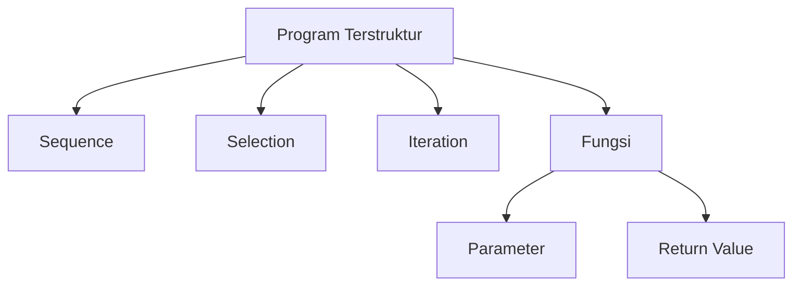
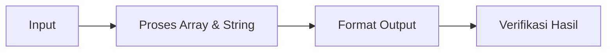
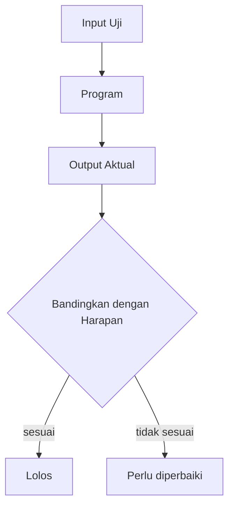

## Universitas Harkat Negeri
### SIF3002 — Dasar Pemrograman

Bima Laksana Putra, S.ST., M.M.

# ARRAY, STRING, INPUT-OUTPUT, FORMAT OUTPUT, TESTING, DAN VERIFIKASI HASIL PROGRAM

# Capaian Pembelajaran

Setelah mempelajari materi ini, mahasiswa diharapkan mampu:

1. Menjelaskan konsep array (list) sebagai kumpulan data dalam Python.
2. Membuat list dan mengakses elemennya menggunakan indeks.
3. Memproses seluruh elemen list menggunakan perulangan.
4. Menjelaskan string sebagai rangkaian karakter dan memanipulasinya.
5. Menggunakan metode string untuk mengolah teks.
6. Membaca banyak data menggunakan `input()` dan menampilkan data dengan `print()`.
7. Memformat output (jumlah desimal, pemisah ribuan, perataan) menggunakan f-string.
8. Menyusun kasus uji (input dan output harapan) untuk menguji program.
9. Memverifikasi hasil program dengan membandingkan output aktual dan harapan serta menelusuri eksekusi.

## Review Materi Sebelumnya

Pada pertemuan sebelumnya kita telah mempelajari:

1. Implementasi sequence, selection, dan iteration dalam Python.
2. Fungsi, parameter, dan return value.
3. Modularisasi — memecah program menjadi fungsi-fungsi.



**Pertanyaan kunci pertemuan ini:**
> Bagaimana mengolah **banyak data sekaligus** (array/list), mengolah **teks** (string), menampilkan hasil dengan **format yang rapi**, serta memastikan program **benar** melalui testing dan verifikasi?

# Pengantar

Selama ini program kita umumnya mengolah **satu nilai** dalam satu waktu. Program nyata sering harus mengolah **kumpulan data**, misalnya nilai seluruh mahasiswa dalam satu kelas.

Alur program lengkap kini menjadi:



- **Array/list** menyimpan banyak data.
- **String** mengolah teks.
- **Input-output** menghubungkan program dengan pengguna.
- **Format output** membuat hasil mudah dibaca.
- **Testing & verifikasi** memastikan program menghasilkan output yang benar.

> Catatan istilah: materi kuliah menyebut **array**. Dalam Python, struktur yang paling dekat dan paling umum dipakai adalah **list**. Keduanya sama-sama kumpulan data berurutan.

# 1. Array (List)

## 1.1 Apa itu List?

List adalah **kumpulan nilai berurutan** yang disimpan dalam satu variabel.

Analogi:

> List ibarat **daftar nilai** atau **lokar** berpetak. Setiap petak punya nomor (indeks) dan berisi satu nilai.

Contoh nilai lima mahasiswa:

```python
daftar_nilai = [80, 90, 75, 85, 92]
```

| Indeks | 0 | 1 | 2 | 3 | 4 |
| ---- | ---- | ---- | ---- | ---- | ---- |
| Nilai | 80 | 90 | 75 | 85 | 92 |

## 1.2 Membuat List

List ditulis dengan **tanda kurung siku** `[]`, dan tiap elemen dipisah koma.

```python
angka = [1, 2, 3, 4, 5]
nama = ["Andi", "Budi", "Citra"]
campuran = [1, "dua", 3.0, True]
kosong = []
```

> Elemen list boleh berbeda tipe, tetapi umumnya satu list berisi satu jenis data agar mudah diolah.

## 1.3 Mengakses Elemen dengan Indeks

Indeks list dimulai dari **0**.

```python
daftar_nilai = [80, 90, 75, 85, 92]

print(daftar_nilai[0])   # 80
print(daftar_nilai[2])   # 75
print(daftar_nilai[4])   # 92
```

Indeks negatif menghitung dari belakang:

```python
print(daftar_nilai[-1])   # 92 (elemen terakhir)
print(daftar_nilai[-2])   # 85
```

> Mengakses indeks di luar jangkauan (misalnya `daftar_nilai[5]`) akan menyebabkan error.

## 1.4 Panjang List dengan `len()`

Gunakan `len()` untuk mengetahui jumlah elemen.

```python
daftar_nilai = [80, 90, 75, 85, 92]
print(len(daftar_nilai))   # 5
```

## 1.5 Mengubah Elemen

Elemen list dapat diubah dengan menetapkan nilai baru pada indeksnya.

```python
daftar_nilai = [80, 90, 75, 85, 92]
daftar_nilai[2] = 78

print(daftar_nilai)   # [80, 90, 78, 85, 92]
```

## 1.6 Perulangan untuk Memproses List

### Cara 1: Mengulang Langsung Nilainya

```python
daftar_nilai = [80, 90, 75, 85, 92]

for nilai in daftar_nilai:
    print(nilai)
```

### Cara 2: Mengulang Berdasarkan Indeks

```python
daftar_nilai = [80, 90, 75, 85, 92]

for i in range(len(daftar_nilai)):
    print(f"Nilai ke-{i + 1}: {daftar_nilai[i]}")
```

Hasil:

```
Nilai ke-1: 80
Nilai ke-2: 90
Nilai ke-3: 75
Nilai ke-4: 85
Nilai ke-5: 92
```

## 1.7 Operasi Umum pada List

```python
daftar_nilai = [80, 90, 75, 85, 92]

print(sum(daftar_nilai))    # 422 (jumlah seluruh elemen)
print(min(daftar_nilai))    # 75 (nilai terkecil)
print(max(daftar_nilai))    # 92 (nilai terbesar)
```

Menambah elemen di akhir list:

```python
buah = ["apel", "jeruk"]
buah.append("mangga")

print(buah)   # ["apel", "jeruk", "mangga"]
```

## 1.8 Studi Kasus: Rata-rata Nilai

Program menghitung rata-rata nilai mahasiswa menggunakan list.

```python
daftar_nilai = [80, 90, 75, 85, 92]

total = sum(daftar_nilai)
banyak = len(daftar_nilai)
rata_rata = total / banyak

print(f"Jumlah nilai: {total}")
print(f"Banyak data : {banyak}")
print(f"Rata-rata   : {rata_rata}")
```

Hasil:

```
Jumlah nilai: 422
Banyak data : 5
Rata-rata   : 84.4
```

# 2. String

## 2.1 String sebagai Rangkaian Karakter

String adalah **rangkaian karakter**. Sama seperti list, string memiliki indeks dan panjang.

```python
nama = "Bima"
```

| Indeks | 0 | 1 | 2 | 3 |
| ---- | ---- | ---- | ---- | ---- |
| Karakter | B | i | m | a |

## 2.2 Indeks dan Slicing

```python
nama = "Bima"

print(nama[0])     # B
print(nama[-1])    # a
print(len(nama))   # 4
```

**Slicing** mengambil sebagian string dengan `[awal:akhir]` (indeks akhir tidak disertakan).

```python
kata = "Pemrograman"

print(kata[0:5])    # "Pemro"
print(kata[5:])     # "graman"
print(kata[:5])     # "Pemro"
```

## 2.3 Penggabungan dan Pengulangan

```python
depan = "Sistem"
belakang = "Informasi"

print(depan + " " + belakang)   # "Sistem Informasi"
print("Ha" * 3)                 # "HaHaHa"
```

## 2.4 Metode String

Metode string membantu mengolah teks. Metode dipanggil dengan tanda titik `.`.

```python
nama = "  bima laksana  "

print(nama.strip())    # "bima laksana" (menghapus spasi ujung)
print(nama.upper())    # "  BIMA LAKSANA  "
print(nama.lower())    # "  bima laksana  "
print(nama.title())    # "  Bima Laksana  "
```

```python
kalimat = "sistem informasi"

print(kalimat.replace("informasi", "komputer"))   # "sistem komputer"
print(kalimat.split())                            # ["sistem", "informasi"]
print(kalimat.find("informasi"))                  # 7 (posisi awal)
print(kalimat.startswith("sistem"))               # True
print(kalimat.endswith("informasi"))              # True
```

## 2.5 Memeriksa Keanggotaan dengan `in`

```python
prodi = "Sistem Informasi"

print("Informasi" in prodi)   # True
print("Komputer" in prodi)    # False
```

## 2.6 Konversi Tipe

```python
umur = 20
tinggi = 165.5

print("Umur: " + str(umur))              # "Umur: 20"
print("Tinggi: " + str(tinggi))          # "Tinggi: 165.5"

angka = int("100")
desimal = float("3.14")
print(angka + 1)      # 101
print(desimal + 1)    # 4.14
```

> `str()` mengubah angka menjadi teks, sedangkan `int()` dan `float()` mengubah teks menjadi angka.

# 3. Input dan Output

## 3.1 Membaca Input

Fungsi `input()` selalu menghasilkan **teks** (`str`).

```python
nama = input("Masukkan nama: ")
print(f"Halo, {nama}!")
```

## 3.2 Membaca Angka

Untuk perhitungan, ubah hasil `input()` menjadi angka.

```python
umur = int(input("Masukkan umur: "))
tinggi = float(input("Masukkan tinggi: "))
```

## 3.3 Membaca Banyak Nilai dengan `split()`

Satu baris input dapat memuat beberapa nilai yang dipisah spasi. Gunakan `split()` untuk memecahnya.

```python
data = input("Masukkan dua angka dipisah spasi: ")
bagian = data.split()

angka1 = int(bagian[0])
angka2 = int(bagian[1])

print(angka1 + angka2)
```

## 3.4 Membaca Banyak Nilai Menjadi List

Untuk jumlah data yang banyak, gunakan perulangan untuk menyusun list.

```python
banyak = int(input("Masukkan banyak data: "))
nilai = []

for i in range(banyak):
    angka = int(input(f"Masukkan nilai ke-{i + 1}: "))
    nilai.append(angka)

print("Data:", nilai)
print("Jumlah:", sum(nilai))
```

Cara ringkas (list comprehension) untuk membaca nilai yang dipisah spasi:

```python
nilai = [int(x) for x in input("Masukkan nilai dipisah spasi: ").split()]
print("Data:", nilai)
```

## 3.5 Menampilkan Output

`print()` dapat menampilkan beberapa nilai sekaligus dengan pemisah.

```python
nama = "Bima"
umur = 20

print("Nama:", nama, "| Umur:", umur)
```

# 4. Format Output

## 4.1 f-string

f-string menyisipkan nilai variabel ke dalam teks.

```python
nama = "Bima"
umur = 20

print(f"{nama} berusia {umur} tahun.")
```

## 4.2 Jumlah Desimal dengan `.2f`

Gunakan `:.2f` untuk membatasi angka desimal menjadi dua digit.

```python
rata_rata = 84.36667

print(f"{rata_rata:.2f}")   # 84.37
print(f"{rata_rata:.1f}")   # 84.4
```

## 4.3 Pemisah Ribuan dengan `:,`

Gunakan `:,` untuk menambahkan pemisah ribuan.

```python
harga = 1500000

print(f"Rp{harga:,}")        # Rp1,500,000
print(f"Rp{harga:,.2f}")     # Rp1,500,000.00
```

## 4.4 Perataan dan Lebar Kolom

Gunakan `:<`, `:>`, atau `:^` untuk rata kiri, kanan, atau tengah, diikuti lebar kolom.

```python
print(f"{'Nama':<10} {'Nilai':>5}")
print(f"{'Andi':<10} {85:>5}")
print(f"{'Budi':<10} {92:>5}")
```

Hasil:

```
Nama       Nilai
Andi          85
Budi          92
```

## 4.5 Contoh Gabungan

Menampilkan tabel sederhana nilai mahasiswa:

```python
daftar_nilai = [80, 90, 75, 85, 92]

print(f"{'No':<4} {'Nilai':>6}")
print("-" * 12)

for i in range(len(daftar_nilai)):
    print(f"{i + 1:<4} {daftar_nilai[i]:>6}")
```

Hasil:

```
No     Nilai
------------
1         80
2         90
3         75
4         85
5         92
```

# 5. Testing dan Verifikasi Hasil

## 5.1 Apa itu Testing?

Testing adalah kegiatan **menjalankan program dengan berbagai masukan** untuk memastikan program bekerja sesuai keinginan.

> Testing bukan mencari-cari kesalahan, melainkan **membuktikan** program berjalan benar.

## 5.2 Apa itu Verifikasi Hasil?

Verifikasi hasil adalah **memeriksa** apakah keluaran program (output aktual) **sesuai** dengan hasil yang diharapkan (output harapan).



## 5.3 Kasus Uji (Test Case)

Kasus uji terdiri dari **input** dan **output harapan**.

Contoh program kelulusan:

```python
nilai = int(input("Masukkan nilai: "))

if nilai >= 60:
    print("Lulus")
else:
    print("Belum lulus")
```

Kasus uji untuk program di atas:

| No | Input | Output Harapan |
| ---- | ---- | ---- |
| 1 | 75 | Lulus |
| 2 | 55 | Belum lulus |
| 3 | 60 | Lulus |
| 4 | 59 | Belum lulus |
| 5 | 100 | Lulus |

> Kasus 3 dan 4 menguji **nilai batas** (tepat di ambang kelulusan). Inilah kasus yang paling sering menjadi sumber kesalahan.

## 5.4 Menelusuri Eksekusi (Trace Table)

Trace table mencatat nilai variabel langkah demi langkah untuk memeriksa logika program.

```python
total = 0

for angka in [10, 20, 30]:
    total = total + angka

print(total)
```

Trace table:

| Iterasi | angka | total (setelah dijumlah) |
| ---- | ---- | ---- |
| Sebelum loop | — | 0 |
| 1 | 10 | 10 |
| 2 | 20 | 30 |
| 3 | 30 | 60 |

> Dari tabel, kita yakin hasil akhir `total` adalah 60. Program benar jika output-nya 60.

## 5.5 Kasus Batas dan Kasus Khusus

Selain kasus normal, uji juga **kasus batas** dan **kasus khusus**.

- **Nilai batas (boundary):** nilai tepat di batas syarat, misalnya 60 pada kelulusan.
- **Kasus khusus (edge case):** nol, negatif, input kosong, data kosong, nilai maksimum.

Contoh kasus khusus untuk program rata-rata:

| Kasus | Input | Perhatian |
| ---- | ---- | ---- |
| Data kosong | `[]` | Pembagian dengan nol |
| Satu data | `[80]` | Rata-rata sama dengan data |
| Nilai nol | `[0, 0, 0]` | Rata-rata 0 |
| Nilai negatif | `[-5, 5]` | Rata-rata 0 |

## 5.6 Memverifikasi Output Aktual vs Harapan

Jalankan program, lalu catat hasil aktual dan bandingkan dengan harapan.

| No | Input | Harapan | Aktual | Status |
| ---- | ---- | ---- | ---- | ---- |
| 1 | 75 | Lulus | Lulus | Sesuai |
| 2 | 55 | Belum lulus | Belum lulus | Sesuai |
| 3 | 60 | Lulus | Belum lulus | Tidak sesuai |

> Jika ada status **tidak sesuai**, periksa logika program (misalnya operator `>=` tertulis `>`).

## 5.7 Verifikasi Otomatis dengan `assert`

`assert` memeriksa suatu kondisi. Jika kondisi salah, program menampilkan error.

```python
def luas_persegi_panjang(panjang, lebar):
    return panjang * lebar

assert luas_persegi_panjang(8, 5) == 40
assert luas_persegi_panjang(0, 5) == 0

print("Semua pengujian lolos.")
```

Hasil:

```
Semua pengujian lolos.
```

> `assert` berguna untuk memverifikasi fungsi secara otomatis tanpa memeriksa hasil secara manual.

## 5.8 Langkah Testing Sistematis

1. **Tentukan input** yang akan diuji (normal, batas, khusus).
2. **Tentukan output harapan** untuk setiap input.
3. **Jalankan program** dengan setiap input.
4. **Bandingkan** output aktual dengan harapan.
5. **Perbaiki** program jika ada perbedaan.

## 5.9 Studi Kasus Terpadu: Pengolahan Nilai + Testing

Program menghitung jumlah, rata-rata, nilai terkecil, dan terbesar dari daftar nilai, lalu menampilkannya dengan format rapi.

```python
def ringkasan_nilai(daftar):
    total = sum(daftar)
    banyak = len(daftar)
    rata = total / banyak
    return total, rata, min(daftar), max(daftar)

def main():
    nilai = [80, 90, 75, 85, 92]
    total, rata, terkecil, terbesar = ringkasan_nilai(nilai)

    print(f"{'Jumlah':<10} {total:>6}")
    print(f"{'Rata-rata':<10} {rata:>6.2f}")
    print(f"{'Terkecil':<10} {terkecil:>6}")
    print(f"{'Terbesar':<10} {terbesar:>6}")

main()
```

Hasil:

```
Jumlah         422
Rata-rata    84.40
Terkecil       75
Terbesar       92
```

Kasus uji untuk fungsi `ringkasan_nilai`:

| No | Input | Output Harapan |
| ---- | ---- | ---- |
| 1 | `[80, 90, 75, 85, 92]` | total 422, rata-rata 84.4, min 75, max 92 |
| 2 | `[60]` | total 60, rata-rata 60.0, min 60, max 60 |
| 3 | `[0, 0, 0]` | total 0, rata-rata 0.0, min 0, max 0 |

Verifikasi dengan `assert`:

```python
assert ringkasan_nilai([80, 90, 75, 85, 92]) == (422, 84.4, 75, 92)
assert ringkasan_nilai([60]) == (60, 60.0, 60, 60)
assert ringkasan_nilai([0, 0, 0]) == (0, 0.0, 0, 0)

print("Semua pengujian lolos.")
```

# 6. Studi Kasus Nyata: Pengolahan Nilai Mahasiswa

## Skenario

Bagian akademik ingin mengolah nilai ujian satu kelas. Dari daftar nilai, sistem harus:

1. Menampilkan setiap nilai beserta **grade** dan **status kelulusan**.
2. Menghitung **rata-rata** kelas.
3. Menghitung **jumlah mahasiswa yang lulus**.

Kasus ini memadukan **array (list)** untuk menyimpan data, **selection** untuk menentukan grade dan status, serta **iteration** untuk memproses seluruh data.

## Program Lengkap

```python
def tentukan_grade(nilai):
    if nilai >= 90:
        return "A"
    elif nilai >= 80:
        return "B"
    elif nilai >= 70:
        return "C"
    elif nilai >= 60:
        return "D"
    else:
        return "E"

def tentukan_status(nilai):
    if nilai >= 60:
        return "Lulus"
    else:
        return "Belum lulus"

def main():
    banyak = int(input("Banyak mahasiswa: "))
    daftar_nilai = []

    # Iteration + input: mengisi list
    for i in range(banyak):
        nilai = int(input(f"Masukkan nilai mahasiswa ke-{i + 1}: "))
        daftar_nilai.append(nilai)

    total = sum(daftar_nilai)
    rata_rata = total / banyak

    # Iteration + selection: klasifikasi dan penghitungan
    jumlah_lulus = 0
    print(f"\n{'No':<4} {'Nilai':>6} {'Grade':>6} {'Status':>12}")
    print("-" * 32)

    for i in range(len(daftar_nilai)):
        nilai = daftar_nilai[i]
        grade = tentukan_grade(nilai)
        status = tentukan_status(nilai)

        if status == "Lulus":
            jumlah_lulus = jumlah_lulus + 1

        print(f"{i + 1:<4} {nilai:>6} {grade:>6} {status:>12}")

    print("-" * 32)
    print(f"{'Rata-rata':<10} {rata_rata:>6.2f}")
    print(f"{'Lulus':<10} {jumlah_lulus} dari {banyak} mahasiswa")

main()
```

## Contoh Jalannya Program

Input: `5`, lalu nilai `80`, `90`, `75`, `85`, `92`.

```
Banyak mahasiswa: 5
Masukkan nilai mahasiswa ke-1: 80
Masukkan nilai mahasiswa ke-2: 90
Masukkan nilai mahasiswa ke-3: 75
Masukkan nilai mahasiswa ke-4: 85
Masukkan nilai mahasiswa ke-5: 92

No    Nilai  Grade       Status
--------------------------------
1        80      B        Lulus
2        90      A        Lulus
3        75      C        Lulus
4        85      B        Lulus
5        92      A        Lulus
--------------------------------
Rata-rata   84.40
Lulus      5 dari 5 mahasiswa
```

## Identifikasi Struktur

| Bagian program | Konsep |
| ---- | ---- |
| `daftar_nilai` | Array (list) untuk menyimpan banyak nilai |
| `for i in range(banyak)` mengisi data | Iteration |
| `tentukan_grade` / `tentukan_status` | Selection (`if-elif-else`) di dalam fungsi |
| `if status == "Lulus"` menghitung lulus | Selection di dalam iteration |
| `f"{nilai:>6}"` dan sejenisnya | Format output |
| Fungsi-fungsi terpisah | Modularisasi |

## Pengembangan (Latihan Mandiri)

1. Tambahkan perhitungan **nilai tertinggi** dan **terendah**.
2. Tampilkan **persentase kelulusan**.
3. Tampilkan daftar mahasiswa yang **nilainya di atas rata-rata**.

# 7. Kesalahan Umum

1. **Indeks mulai dari 1.** Indeks Python dimulai dari 0, sehingga elemen pertama adalah indeks `0`.
2. **Mengakses indeks di luar jangkauan.** Misalnya list berisi 5 elemen tetapi mengakses indeks `5`.
3. **Lupa mengubah input angka.** `input()` menghasilkan teks; gunakan `int()` atau `float()`.
4. **Menggabungkan angka dan teks tanpa `str()`.** Misalnya `print("Nilai: " + 85)` akan error.
5. **Salah memahami `range()`.** `range(5)` menghasilkan 0 sampai 4, bukan 1 sampai 5.
6. **Membagi dengan nol.** Pastikan jumlah data tidak nol sebelum menghitung rata-rata.
7. **Mengira `min()`/`max()` bekerja pada list kosong.** List kosong akan menyebabkan error.
8. **Tidak menguji kasus batas.** Banyak kesalahan baru terlihat saat nilai tepat di ambang batas.

# Kuis Cepat

**1.** Apa hasil program berikut?

```python
daftar = [10, 20, 30, 40]
print(daftar[1])
```

**2.** Apa hasil program berikut?

```python
kata = "Python"
print(kata[0:3])
```

**3.** Apa hasil program berikut?

```python
kata = "Sistem Informasi"
print(kata.split())
```

**4.** Apa hasil program berikut?

```python
print(len([5, 6, 7, 8]))
```

**5.** Apa hasil program berikut?

```python
angka = [1, 2, 3]
print(sum(angka))
```

**6.** Tuliskan kode untuk menampilkan angka `3.14159` menjadi dua desimal.

**7.** Apa output program berikut jika pengguna memasukkan `65`?

```python
nilai = int(input("Nilai: "))

if nilai >= 60:
    print("Lulus")
else:
    print("Belum lulus")
```

**8.** Sebutkan tiga kasus yang perlu diuji pada program rata-rata (selain kasus normal).

# Tugas

## Latihan 1: Daftar Nilai

Buat program yang menyimpan lima nilai dalam list, lalu tampilkan jumlah, rata-rata, nilai terkecil, dan nilai terbesar. Gunakan format dua desimal untuk rata-rata.

## Latihan 2: Manipulasi String

Buat program yang menerima nama lengkap pengguna, lalu tampilkan:

1. Nama dalam huruf kapital (`upper()`).
2. Jumlah karakter (tanpa spasi).
3. Nama depan (kata pertama dari `split()`).

## Latihan 3: Membaca Banyak Data

Buat program yang menerima sejumlah nilai dari pengguna (pengguna memasukkan banyaknya data terlebih dahulu), menyimpannya ke list, lalu menampilkan jumlah dan rata-ratanya.


## Ketentuan

1. Dikerjakan secara individu.
2. Setiap program disimpan dalam file `.py` yang terpisah.
3. Gunakan nama variabel dan fungsi (nilai + ) yang jelas serta konsisten.
4. Gunakan list untuk menyimpan kumpulan data dan string untuk mengolah teks.
5. Gunakan f-string untuk memformat output (desimal, ribuan, perataan kolom).
6. Sertakan kasus uji (tabel input dan output harapan) untuk Latihan 5.
7. Pastikan program dapat dijalankan dan hasilnya terverifikasi.
8. Kumpulkan hasil eksekusi (screenshot output) beserta file kodenya.
