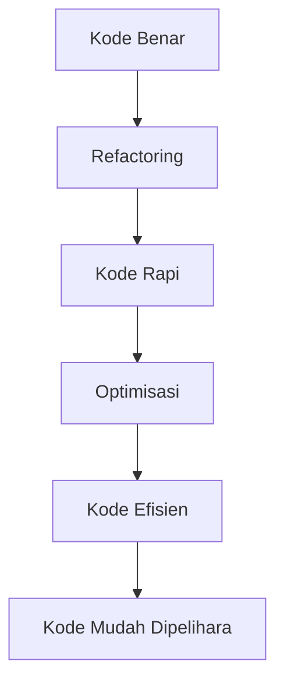

## Universitas Harkat Negeri
### SIF3002 — Dasar Pemrograman

Bima Laksana Putra, S.ST., M.M.

# PERBAIKAN ERROR, REFACTORING, OPTIMISASI KODE, NAMING CONVENTION, COMMENT, DAN CODE ORGANIZATION

# Capaian Pembelajaran

Setelah mempelajari materi ini, mahasiswa diharapkan mampu:

1. Memperbaiki kesalahan logika (logic error) dan sintaks (syntax error) secara sistematis.
2. Menjelaskan pengertian dan tujuan refactoring.
3. Melakukan refactoring sederhana: mengekstrak fungsi, menghilangkan duplikasi, dan menyederhanakan kondisi.
4. Menjelaskan pengertian optimisasi kode dan kapan perlu dilakukan.
5. Menerapkan optimisasi sederhana (memakai fungsi bawaan, menghindari perhitungan berulang).
6. Menggunakan naming convention yang jelas dan konsisten.
7. Menulis komentar dan docstring yang tepat guna.
8. Mengorganisasi kode menjadi bagian-bagian yang terstruktur.

## Review Materi Sebelumnya

Kita sudah belajar menulis program, membaca dan mengklasifikasi error, serta menguji hasil dengan kasus uji. Pertemuan ini kita naik satu tingkat: **membuat kode yang tidak hanya benar, tetapi juga rapi, mudah dibaca, dan mudah dipelihara**.

> Kode yang baik ditulis untuk dibaca oleh manusia, bukan hanya untuk dijalankan komputer.



# 1. Perbaikan Logic dan Syntax Error

## 1.1 Mengingat Kembali Jenis Error

| Jenis | Ciri | Cara menemukan |
| ---- | ---- | ---- |
| Syntax error | Program tidak mau jalan | Pesan error langsung ditampilkan |
| Runtime error | Berhenti di tengah | Traceback saat dijalankan |
| Logic error | Berjalan tetapi hasil salah | Pengujian dan trace |

## 1.2 Alur Memperbaiki Error

1. **Baca pesan error** (untuk syntax dan runtime error).
2. **Temukan baris** yang bermasalah.
3. **Perbaiki** kesalahan penulisan.
4. Untuk logic error: **telusuri nilai variabel** dengan trace table atau `print()` sementara.
5. **Uji kembali** dengan kasus batas.

Contoh logic error pada kelulusan:

```python
nilai = 60

if nilai > 60:
    print("Lulus")
else:
    print("Belum lulus")
```

> Nilai tepat `60` seharusnya lulus. Perbaikannya: ubah `>` menjadi `>=`.

# 2. Refactoring

## 2.1 Apa itu Refactoring?

Refactoring adalah **memperbaiki struktur kode tanpa mengubah perilakunya**.

> Hasil program tetap sama, tetapi kodenya menjadi lebih rapi dan mudah dipahami.

Tujuan refactoring:

1. Kode lebih **mudah dibaca**.
2. Kode lebih **mudah dipelihara**.
3. **Menghilangkan duplikasi**.
4. **Memecah** kode panjang menjadi bagian kecil.

## 2.2 Mengekstrak Fungsi

Kode yang panjang dipecah menjadi fungsi.

**Sebelum:**

```python
panjang1 = 10
lebar1 = 5
luas1 = panjang1 * lebar1

panjang2 = 8
lebar2 = 4
luas2 = panjang2 * lebar2

print(luas1)
print(luas2)
```

**Sesudah:**

```python
def hitung_luas(panjang, lebar):
    return panjang * lebar

luas1 = hitung_luas(10, 5)
luas2 = hitung_luas(8, 4)

print(luas1)
print(luas2)
```

## 2.3 Menghilangkan Duplikasi

Kode yang sama ditulis berulang sebaiknya dijadikan satu fungsi.

**Sebelum (duplikasi):**

```python
print("Menghitung nilai 1")
nilai1 = int(input("Nilai: "))
print(nilai1 * 2)

print("Menghitung nilai 2")
nilai2 = int(input("Nilai: "))
print(nilai2 * 2)
```

**Sesudah (fungsi):**

```python
def hitung_dan_tampilkan(nomor):
    print(f"Menghitung nilai {nomor}")
    nilai = int(input("Nilai: "))
    print(nilai * 2)

hitung_dan_tampilkan(1)
hitung_dan_tampilkan(2)
```

## 2.4 Menyederhanakan Kondisi

`if` bertingkat dapat disederhanakan dengan `elif`.

**Sebelum:**

```python
if nilai >= 90:
    grade = "A"
else:
    if nilai >= 80:
        grade = "B"
    else:
        if nilai >= 70:
            grade = "C"
        else:
            grade = "D"
```

**Sesudah:**

```python
if nilai >= 90:
    grade = "A"
elif nilai >= 80:
    grade = "B"
elif nilai >= 70:
    grade = "C"
else:
    grade = "D"
```

## 2.5 Mengganti Angka "Ajaib" dengan Konstanta

Angka yang muncul tanpa penjelasan disebut *magic number*.

**Sebelum:**

```python
if total > 500000:
    total = total * 0.9
```

**Sesudah:**

```python
BATAS_DISKON = 500_000
PERSEN_DISKON = 0.9

if total > BATAS_DISKON:
    total = total * PERSEN_DISKON
```

# 3. Optimisasi Kode

## 3.1 Apa itu Optimisasi?

Optimisasi adalah membuat kode **lebih efisien** (lebih cepat atau lebih hemat) **tanpa mengubah hasil**.

> Prioritaskan keterbacaan terlebih dahulu. Optimalkan hanya jika memang diperlukan.

## 3.2 Memakai Fungsi Bawaan

Python menyediakan fungsi bawaan yang lebih ringkas dan efisien.

**Sebelum:**

```python
total = 0
for nilai in daftar_nilai:
    total = total + nilai
```

**Sesudah:**

```python
total = sum(daftar_nilai)
```

## 3.3 Menghindari Perhitungan Berulang

Hitung nilai yang sama **sekali saja**, lalu simpan ke variabel.

**Sebelum:**

```python
for i in range(len(daftar_nilai)):
    print(daftar_nilai[i] * len(daftar_nilai))
```

**Sesudah:**

```python
banyak = len(daftar_nilai)
for i in range(banyak):
    print(daftar_nilai[i] * banyak)
```

## 3.4 Berhenti Lebih Awal dengan `break` atau `return`

Jika tujuan sudah tercapai, tidak perlu melanjutkan perulangan.

```python
def ada_nilai_negatif(daftar):
    for nilai in daftar:
        if nilai < 0:
            return True
    return False
```

> Begitu ditemukan nilai negatif, fungsi langsung `return` dan tidak memproses sisa data.

## 3.5 Jangan Optimisasi Berlebihan

- Jangan mengorbankan keterbacaan demi sedikit kecepatan.
- Ukur dulu bagian mana yang lambat sebelum mengoptimalkan.
- Kode yang jelas lebih mudah dioptimalkan di kemudian hari.

# 4. Naming Convention

## 4.1 Aturan Umum

Nama harus **menggambarkan isi atau tujuan**, bukan sekadar singkatan.

| Aturan | Contoh benar | Contoh salah |
| ---- | ---- | ---- |
| Variabel: kata benda, huruf kecil + garis bawah | `jumlah_mahasiswa`, `total` | `jm`, `t`, `data1` |
| Fungsi: kata kerja | `hitung_luas()`, `tampilkan_menu()` | `f1()`, `proses()` |
| Boolean: awalan `is_` / `sudah_` | `is_lulus`, `sudah_login` | `cek`, `flag` |
| Konstanta: huruf besar + garis bawah | `BATAS_LULUS`, `PI` | `batas`, `p` |

## 4.2 Contoh Perbandingan

**Sebelum (tidak jelas):**

```python
x = 80
y = 90
z = 75
t = x + y + z
r = t / 3
print(r)
```

**Sesudah (jelas):**

```python
nilai1 = 80
nilai2 = 90
nilai3 = 75
total = nilai1 + nilai2 + nilai3
rata_rata = total / 3
print(rata_rata)
```

## 4.3 Hal yang Perlu Dihindari

1. Nama satu huruf tanpa arti (`x`, `a`, `b`).
2. Singkatan tidak jelas (`nm`, `jml`, `hsl`).
3. Nama yang sama untuk tujuan berbeda.
4. Nama yang menyesatkan (misalnya variabel `total` yang berisi rata-rata).

# 5. Comments

## 5.1 Kapan Perlu Komentar?

Komentar menjelaskan **MENGAPA** kode ditulis seperti itu, bukan **APA** yang dilakukan kode.

> Kode yang jelas sering tidak membutuhkan komentar. Komentar diperlukan saat maksudnya tidak terlihat langsung.

## 5.2 Komentar yang Baik vs Buruk

**Buruk (mengulang kode):**

```python
total = total + nilai   # menambahkan nilai ke total
```

**Baik (menjelaskan alasan):**

```python
# Diskon hanya berlaku untuk total belanja di atas Rp500.000
if total > 500_000:
    total = total * 0.9
```

## 5.3 Docstring

Docstring menjelaskan **fungsi** secara singkat. Ditulis tepat di bawah baris `def`.

```python
def hitung_luas(panjang, lebar):
    """Mengembalikan luas persegi panjang."""
    return panjang * lebar
```

# 6. Code Organization

## 6.1 Struktur Program yang Baik

Susun kode dengan urutan berikut:

1. **Konstanta**.
2. **Fungsi-fungsi** (logika).
3. **Program utama** (`main()`).

```python
BATAS_LULUS = 60


def tentukan_status(nilai):
    if nilai >= BATAS_LULUS:
        return "Lulus"
    return "Belum lulus"


def main():
    nilai = int(input("Masukkan nilai: "))
    print(tentukan_status(nilai))


if __name__ == "__main__":
    main()
```

## 6.2 Prinsip Organisasi

1. **Satu fungsi, satu tugas.** Fungsi tidak boleh terlalu panjang.
2. **Pisahkan logika dari input/output.** Fungsi logika tidak memanggil `input()` atau `print()`.
3. **Kelompokkan kode yang berhubungan** berdekatan.
4. **Gunakan `if __name__ == "__main__":`** agar program utama hanya berjalan saat file dijalankan langsung.

> `if __name__ == "__main__":` membuat fungsi dapat dipakai ulang oleh program lain tanpa langsung menjalankan `main()`.

# 7. Studi Kasus: Dari Kode Berantakan Menjadi Kode Rapi

## Sebelum

Program menghitung rata-rata dan status kelulusan, tetapi penamaannya tidak jelas dan logikanya tercampur.

```python
n1 = 80
n2 = 90
n3 = 75
t = n1 + n2 + n3
r = t / 3
print(r)
if r >= 60:
    print("lulus")
else:
    print("tidak lulus")
```

## Sesudah

```python
BATAS_LULUS = 60


def hitung_rata_rata(daftar_nilai):
    """Mengembalikan rata-rata dari daftar nilai."""
    return sum(daftar_nilai) / len(daftar_nilai)


def tentukan_status(nilai):
    """Mengembalikan status kelulusan berdasarkan nilai."""
    if nilai >= BATAS_LULUS:
        return "Lulus"
    return "Tidak lulus"


def main():
    daftar_nilai = [80, 90, 75]
    rata_rata = hitung_rata_rata(daftar_nilai)

    print(f"Rata-rata: {rata_rata:.2f}")
    print(f"Status: {tentukan_status(rata_rata)}")


if __name__ == "__main__":
    main()
```

Perubahan yang dilakukan:

| Aspek | Sebelum | Sesudah |
| ---- | ---- | ---- |
| Nama variabel | `n1`, `t`, `r` | `daftar_nilai`, `rata_rata` |
| Konstanta | `60` (angka ajaib) | `BATAS_LULUS` |
| Fungsi | Tidak ada | `hitung_rata_rata`, `tentukan_status` |
| Docstring | Tidak ada | Ada |
| Struktur | Logika tercampur | Terpisah dan teratur |

# 8. Kesalahan Umum

1. **Komentar mengulang kode**, bukan menjelaskan alasan.
2. **Nama variabel tidak jelas** (`x`, `data1`, `temp`).
3. **Duplikasi kode** yang seharusnya dijadikan fungsi.
4. **Fungsi terlalu panjang** mengerjakan banyak tugas.
5. **Angka ajaib** tanpa konstanta.
6. **Optimisasi berlebihan** yang membuat kode sulit dibaca.
7. **Logika tercampur input/output** dalam satu fungsi.
8. **Tidak konsisten** dalam penamaan (campur gaya penulisan).

# Kuis Cepat

**1.** Mana nama variabel yang lebih baik untuk menyimpan jumlah mahasiswa?

```python
# a) jm
# b) jumlah_mahasiswa
# c) data
```

**2.** Sederhanakan kode berikut:

```python
total = 0
for nilai in daftar:
    total = total + nilai
```

**3.** Mana komentar yang lebih baik?

```python
# a) x = x + 1   # menambah satu ke x
# b) x = x + 1   # pindah ke mahasiswa berikutnya
```

**4.** Apa fungsi `if __name__ == "__main__":`?

**5.** Mana yang merupakan penulisan konstanta yang benar?

```python
# a) batas_lulus = 60
# b) BATAS_LULUS = 60
# c) BatasLulus = 60
```

**6.** Mengapa angka `500000` pada `if total > 500000:` sebaiknya diganti konstanta?

# Tugas

## Latihan 1: Refactoring

Program berikut mengolah daftar nilai: menghitung rata-rata, menghitung jumlah yang lulus, dan menampilkan grade setiap nilai. Namun penamaannya tidak jelas, ada angka ajaib, logika ambang kelulusan terduplikasi, dan belum terpecah menjadi fungsi.

```python
d = [80, 90, 75, 85, 92]

t = 0
for i in d:
    t = t + i
r = t / len(d)
print(r)

n = 0
for i in d:
    if i >= 60:
        n = n + 1
print(n)

for i in d:
    if i >= 90:
        print("A")
    elif i >= 80:
        print("B")
    elif i >= 70:
        print("C")
    elif i >= 60:
        print("D")
    else:
        print("E")
```

Lakukan refactoring:

1. Ganti nama variabel yang tidak jelas (`d`, `t`, `r`, `n`, `i`).
2. Ganti angka ajaib (`60`, `90`, `80`, `70`) dengan konstanta.
3. Pecah menjadi fungsi: `hitung_rata_rata`, `hitung_jumlah_lulus`, dan `tentukan_grade`.
4. Hilangkan duplikasi logika ambang kelulusan (`60` muncul di beberapa tempat).
5. Susun kode dengan struktur yang baik: konstanta di atas, fungsi logika, lalu `main()`.

## Latihan 2: Optimisasi

Sederhanakan program berikut agar lebih ringkas dan efisien tanpa mengubah hasil. Perhatikan: total dihitung dua kali, dan perulangan memakai indeks manual yang sebenarnya tidak diperlukan.

```python
angka = [12, 45, 7, 23, 89, 34, 5, 67, 90, 18]

total = 0
for i in range(len(angka)):
    total = total + angka[i]

rata_rata = 0
for i in range(len(angka)):
    rata_rata = rata_rata + angka[i]
rata_rata = rata_rata / len(angka)

terbesar = angka[0]
for i in range(len(angka)):
    if angka[i] > terbesar:
        terbesar = angka[i]

terkecil = angka[0]
for i in range(len(angka)):
    if angka[i] < terkecil:
        terkecil = angka[i]

print(total)
print(rata_rata)
print(terbesar)
print(terkecil)
```

## Latihan 3: Naming dan Comment

Perbaiki penamaan variabel/fungsi, ganti angka ajaib dengan konstanta, tambahkan docstring, dan perbaiki komentar (hapus yang mengulang kode) pada program berikut.

```python
def f(x):
    # menghitung x kali x kali phi
    return x * x * 3.14

def g(n):
    # jika n lebih dari sama dengan 60 maka true
    if n >= 60:
        return True
    else:
        return False

r = 7
s = 75

print(f(r))
print(g(s))
```

## Latihan 4: Organisasi Kode

Susun ulang program berikut menjadi: konstanta di atas, fungsi logika terpisah dari input/output, lalu `main()` dengan `if __name__ == "__main__":`.

```python
print("=== Pengolahan Nilai ===")
n = int(input("Banyak nilai: "))
data = []
for i in range(n):
    v = int(input("Nilai: "))
    data.append(v)

total = 0
for v in data:
    total = total + v
rata = total / n

print("Rata-rata:", rata)
if rata >= 60:
    print("Status: Lulus")
else:
    print("Status: Tidak Lulus")
```
